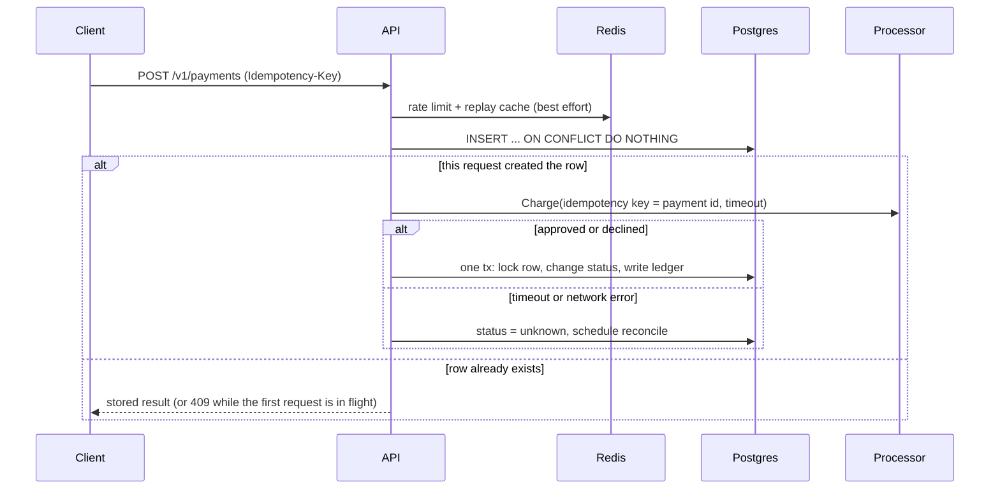
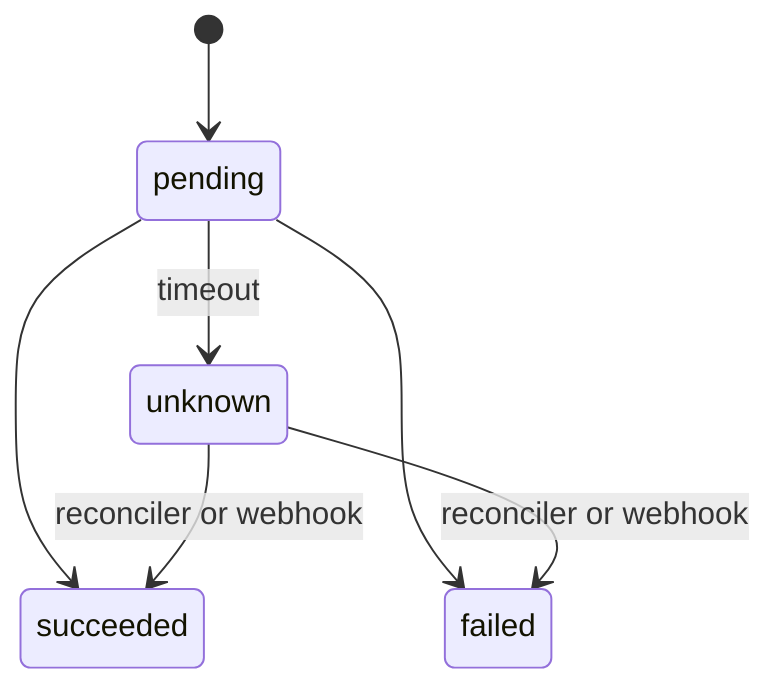

# PayLite: charge a customer exactly once

A small Go service that solves one problem payment systems must get right: **a customer is never charged twice, and a payment is never lost, even when requests are retried, run concurrently, time out, or the server crashes mid-flight.**

Built with Go, PostgreSQL and Redis. Money is integer cents, Postgres is the source of truth, and Redis is only a speed layer: with Redis completely down, the guarantees still hold (there is a test for that).

## The problem

A client sends "charge $125". The network drops the response, so the client retries. A naive service charges again.

It gets worse. If the call to the payment processor **times out**, you don't know whether the money moved. Marking the payment "failed" and retrying risks a double charge. Marking it "succeeded" risks giving away goods for free. The only honest state is **unknown**, followed by asking the processor what actually happened.

## What this service guarantees

| Guarantee | How |
| --- | --- |
| One charge per idempotency key, under any concurrency | `INSERT ... ON CONFLICT DO NOTHING` on `UNIQUE (merchant_id, idempotency_key)`: exactly one request wins and is allowed to call the processor |
| A timeout is never treated as a failure | The payment becomes `unknown`; a reconciler asks the processor, and only re-sends with the **same** idempotency key if the processor never saw it |
| The same key can't be reused for a different payment | Requests are fingerprinted; a mismatch returns `422` |
| Money is booked once, and the books balance | Status change and double-entry ledger rows are written in one transaction; `UNIQUE (payment_id, account, direction)` blocks a second booking |
| Illegal state changes are impossible | One state machine, one code path (`applyTx`) shared by the charge, the reconciler and the webhook handler |
| Webhooks are safe to duplicate, reorder or forge | HMAC signature check; the event ID is stored in the **same transaction** as the state change |
| A crash can't strand a payment | Rows stuck in `pending` past a deadline are swept by the reconciler |
| Redis outages don't cause double charges | Every Redis call fails open to Postgres |

**Not guaranteed (on purpose, see "What I would do next"):** real authentication, exactly-once delivery of *outbound* webhooks, refunds, multi-currency settlement.

## How it works





`succeeded` and `failed` are final. A webhook that contradicts a final state is recorded and ignored, and logged for a human.

### Design decisions worth knowing

- **Postgres decides, Redis helps.** Redis provides a per-merchant rate limit (atomic Lua script) and a replay cache for finished payments. If it errors, the service logs and continues. A lock in Redis is deliberately *not* used to prevent double charges, because locks can expire while work is still running.
- **The processor gets our payment ID as its idempotency key**, so even a repeated call can't charge twice on their side. Our own guard still has to stop duplicate calls: the tests assert the processor was *called* once, not just that it charged once.
- **The outcome is saved with a context that ignores client cancellation** (`context.WithoutCancel`), because losing the record of a charge that really happened is the worst failure.
- **The reconciler uses leases and `FOR UPDATE SKIP LOCKED`**, so any number of workers or instances can run it without double-processing a payment.
- **After too many attempts a payment is "parked"** with an audit note for manual review instead of retrying forever.
- **The same status code is returned on replay.** The mapping depends only on the payment status: `201` succeeded, `402` declined, `202` unknown, `409` still in progress.

## API

| Method and path | Purpose |
| --- | --- |
| `POST /v1/payments` | Create a payment. Headers: `X-Merchant-ID` (stand-in for auth), `Idempotency-Key`. Body: `amount_cents`, `currency`, `customer_ref` |
| `GET /v1/payments/{id}` | Fetch a payment (only for the merchant that owns it) |
| `POST /webhooks/processor` | Processor events (`payment.succeeded`, `payment.failed`), signed with HMAC-SHA256 in `X-Signature` |
| `GET /healthz` | Liveness |

Responses: `201` created, `202` outcome unknown, `402` declined, `409` same key still in flight (retry shortly), `422` key reused with a different payload, `429` rate limited (with `Retry-After`), `400` invalid input.

```bash
curl -X POST localhost:8080/v1/payments \
  -H 'X-Merchant-ID: demo_merchant' -H 'Idempotency-Key: order-1001' \
  -H 'Content-Type: application/json' \
  -d '{"amount_cents": 12500, "currency": "USD", "customer_ref": "cus_demo"}'
```

## Run it

You need Go 1.22+ and Docker.

```bash
# everything in Docker
make stack            # API + Postgres + Redis on :8080
make demo             # replays the three failure scenarios below

# or develop locally
make up               # Postgres + Redis only
make test             # go test -race against the real services
make run              # API on :8080
```

If Go complains about checksums on first run: `rm go.sum && go mod tidy`.

### Demo output

`scripts/demo.sh` against a running server (the processor is artificially slow so the race is visible):

```text
== 1. Thirty identical requests at the same instant
   HTTP       5 201
   HTTP      25 409
   processor : {"approved_charges":1,"charge_calls":1,"mode":"approve"}
   ledger    : {"balanced":true,"credits_cents":12500,"debits_cents":12500,"entries":2}
   -> money moved exactly once, and the books balance.

== 2. The processor takes the money, then the response is lost (timeout)
   first request   : HTTP 202  (202 = outcome unknown, NOT a failure)
   client retries  : HTTP 202  (same key: no second charge)
   payment status  : succeeded        <- the reconciler looked it up
   -> still one charge per payment.

== 3. Webhooks: duplicates and contradictions
   webhook succeeded : {"result":"applied"}
   same event again  : {"result":"duplicate"}
   later 'failed'    : {"result":"ignored"}
   final status      : succeeded
```

(The processor counter in scenario 2 shows 2 because scenario 1 already made 1 charge: one charge per payment, never two for the same payment.)

## Tests

Integration tests run against real Postgres and Redis, with the race detector on. Locally they skip if the databases aren't reachable; CI sets `REQUIRE_INTEGRATION=1` so a missing database fails the build.

| Scenario | Test |
| --- | --- |
| 50 identical requests at once, Redis up and Redis down | `TestConcurrentDuplicatesChargeOnce` |
| Same key, different amount | `TestKeyReuseWithDifferentPayloadIsRejected` |
| Decline is final, even after the processor recovers | `TestDeclineIsFinalAndReplayed` |
| Processor charged, response lost | `TestTimeoutAfterChargeBecomesUnknownThenReconciles` |
| Processor never got the charge | `TestTimeoutBeforeChargeIsRetriedSafely` |
| Crash after insert, before the charge | `TestOrphanedPendingPaymentIsRecovered` |
| Processor unreachable for a long time | `TestUnresolvablePaymentIsParkedForManualReview` |
| Several reconcilers running at once | `TestConcurrentReconcilersNeverDoubleProcess` |
| Duplicate and contradictory webhooks | `TestWebhookSettlesUnknownPaymentExactlyOnce` |
| Forged, malformed or unknown-payment webhooks | `TestWebhookRejectsBadInput` |
| Replay headers, error codes, tenant isolation | `TestCreateReplayAndErrors` |
| Rate limiting | `TestRateLimit` |
| State machine and validation | `TestCanTransition`, `TestRequestValidationAndHash` |

These tests were verified to catch real bugs by breaking the code on purpose: treating a timeout as `failed` makes three tests fail, and disabling the state machine makes the webhook test fail.

## Project layout

```text
cmd/api/                 entry point, wiring, graceful shutdown
internal/payments/       state machine, Postgres store, service, reconciler, schema.sql
internal/processor/      Processor interface + a fake that can time out, decline, or drop requests
internal/cache/          Redis rate limiter and replay cache
internal/httpapi/        routes, webhook verification, error mapping
internal/testutil/       real Postgres + Redis test environment
scripts/demo.sh          the three scenarios, end to end
```

## What I would do next

- Replace the fake with a real processor adapter (it only has to implement two methods) and use its sandbox for contract tests.
- Real authentication (API keys or JWT) instead of the `X-Merchant-ID` header.
- Add a timestamp to the webhook signature to prevent replay of old signed events.
- An outbox table so *outbound* webhooks to merchants are delivered at least once with retries.
- Idempotency-key expiry and archival (keys are kept forever today).
- Refunds and partial captures as new transitions in the same state machine.
- Metrics and tracing (payment success rate, `unknown` count and age, reconcile attempts), plus an alert on parked payments.
- Switch `database/sql` + `lib/pq` to `pgx` for native Postgres features; the store is the only place that changes.
- Load-test the `ON CONFLICT` hot path and tune the connection pool.

## License

MIT
